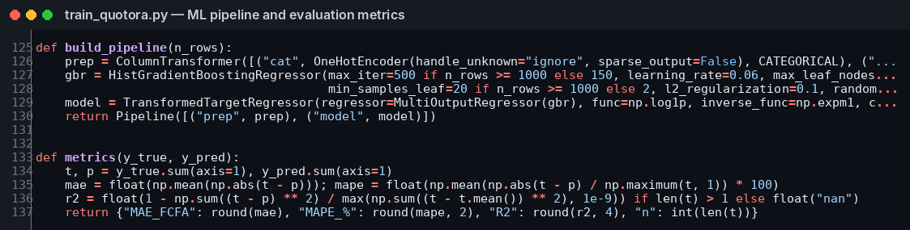
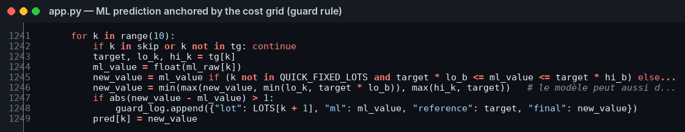
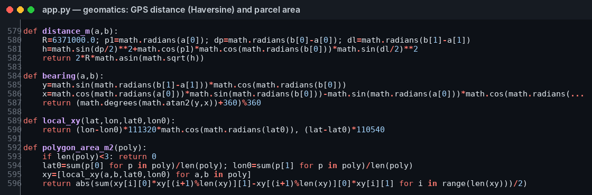
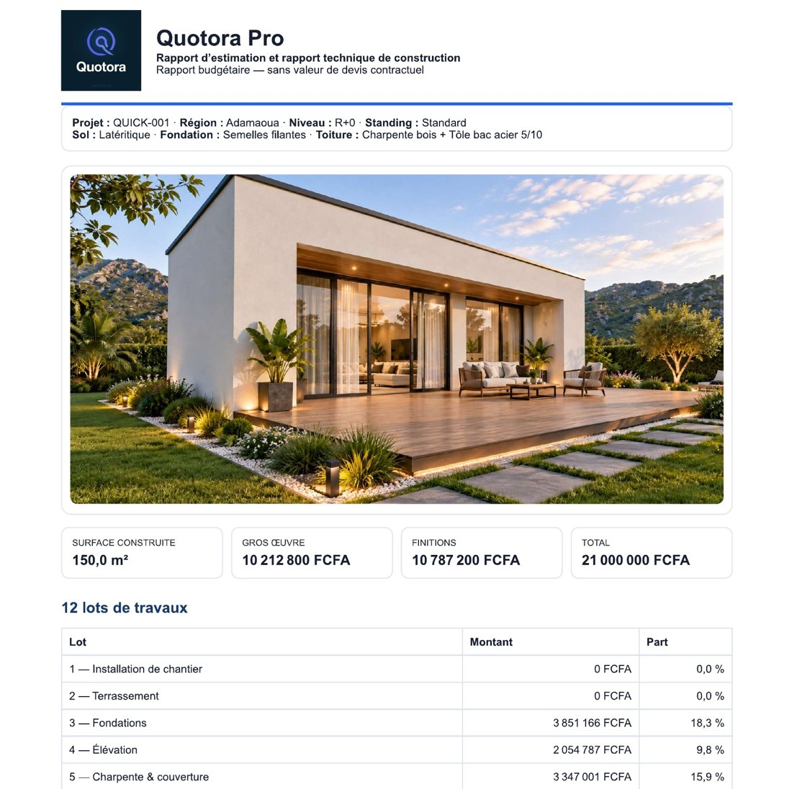

# Quotora Pro — Construction Cost Estimation for Cameroon (Machine Learning + Geomatics)

**Author:** Tsala Christian — Data Scientist · Geomatics · Construction professional since 2016
**Live application:** https://quotora.streamlit.app (access-code protected; a reviewer code is available on request)
**Project website and demo videos:** https://quotora-pro.netlify.app
**Contact:** rosatsala@gmail.com · +237 675 26 06 58

Quotora Pro estimates the cost of a building in Cameroon across 12 work packages (site set-up, earthworks, foundations, walls and reinforced-concrete frame, roofing, plastering, joinery, plumbing, electrical, finishes, external works, floors and slabs). It combines a multi-output machine-learning model, a cost grid calibrated on real construction quotes, and geomatics tools for the plot.

This repository is a **public showcase** for academic review. The full application source is kept private because the application is a commercial product; the files here show the core methods, the training code and real outputs.

## What the application does

| Module | What it does |
| --- | --- |
| Quick estimate | 6 inputs (region, ground-floor area, number of storeys, quality level, wall type, roof) → cost of 12 work packages, total and cost per m² |
| Professional estimate | Package-by-package quantities and unit prices (concrete volumes, walls, rendering, joinery, plumbing, electrical, external works); user entries override the model |
| Plan reading | DXF drawings parsed layer by layer (wall lengths, room areas, openings); image/PDF plans read by an AI model with user consent |
| Site & map | GPS plot outline → area (shoelace formula on a local projection), side lengths (Haversine), relief from a global DEM (Copernicus GLO-90 via Open-Meteo) or an uploaded GeoTIFF, retaining-wall screening |
| Reports | Printable report in French or English, editable Excel bill of quantities, JSON project file, 15 currencies |
| Showcase | Directory of architects and engineers (Supabase database + file storage, watermarked images) |
| Access | Paid, time-limited access codes signed with HMAC-SHA256 (Mobile Money / Orange Money) |

## Machine-learning model

- **Algorithm:** `HistGradientBoostingRegressor` (scikit-learn 1.9.1) wrapped in `MultiOutputRegressor` → 10 outputs (work packages 2–11) predicted at once.
- **Target transform:** `log1p` / `expm1` (`TransformedTargetRegressor`) so that errors are relative and very large buildings do not dominate training.
- **Features (23):** 11 categorical (region, wall type, roof, foundation, soil, quality level, season, site access…) one-hot encoded; 12 numeric (areas per level, external wall area, glazing share, transport distance, regional wall price…).
- **Hyper-parameters:** 500 iterations, learning rate 0.06, 31 leaf nodes, min 20 samples per leaf, L2 = 0.1.
- **Data:** 26,000 synthetic buildings recalibrated on a cost grid derived from real quotes, plus 6 real projects (a completed R+1 house and quotes for R+2 to R+6 buildings in Yaoundé, Douala, Kribi and Mfou), each real project weighted ×217 (real projects = 5 % of total weight).
- **Safety rule:** in quick mode, each package keeps the model output only if it stays within ±35 % of the calibrated grid; otherwise the grid value is used. In professional mode, the model is bounded to ±20 % of the cost computed from the user's quantities.

### Results

Hold-out test on 5,200 buildings never seen in training (20 % split, seed 42):

| Metric | Total cost | Cost per built m² |
| --- | --- | --- |
| R² | 0.987 | 0.977 |
| MAPE | 6.75 % | 6.75 % |
| MAE | 49.6 M FCFA | 16,747 FCFA/m² |
| RMSE | 306.9 M FCFA | 27,230 FCFA/m² |

Leave-one-out validation on the real projects: **5.8 % mean error** on the total (8.3 % for the cost grid alone). Final quick estimates on the reference projects fall between **−4.7 % and +2.4 %** of actual costs.

An earlier version of the project compared four algorithms on a Douala dataset (Gradient Boosting R² 0.890, Linear Regression 0.880, Random Forest 0.817, Decision Tree 0.644); Gradient Boosting was retained.

## Files

| Path | Content |
| --- | --- |
| `src/train_quotora.py` | Training script: data loading, sample weighting, pipeline, hold-out evaluation, model export |
| `src/recalibrer_dataset.py` | Recalibration of the synthetic dataset on the real-quote cost grid |
| `src/quotora_core_formulas.py` | Core formulas extracted from the application: regional factors, per-package cost grid, foundations by number of storeys, geomatics (Haversine, bearing, shoelace area) |
| `screenshots/` | Code extracts and real outputs of the application (printable report, access screen) |

## Technology stack

Python · pandas · NumPy · scikit-learn · joblib · Streamlit · Plotly · Folium · rasterio · openpyxl · Supabase (PostgreSQL + storage) · GitHub · Streamlit Community Cloud · Netlify · Open-Meteo Elevation API · ExchangeRate-API

## Screenshots

---
© Tsala Christian. All rights reserved. Shared for academic review; not licensed for commercial reuse.
